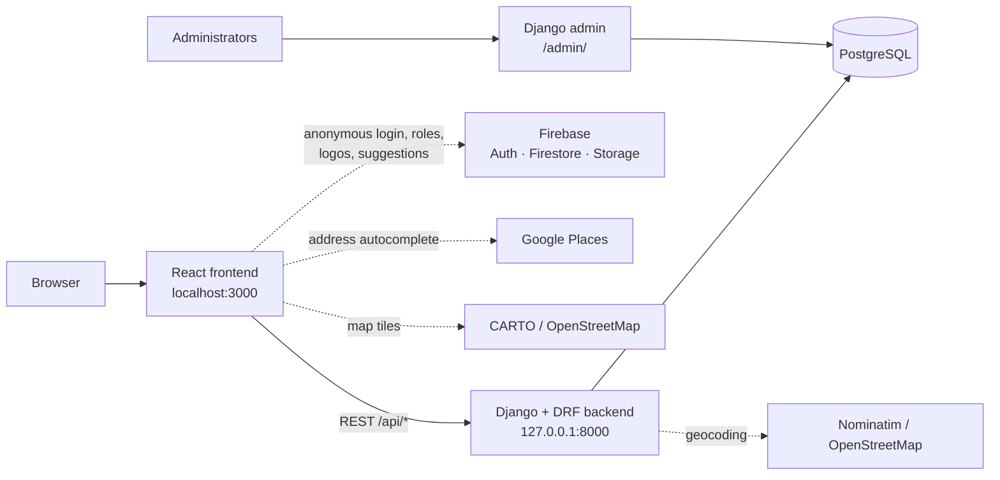
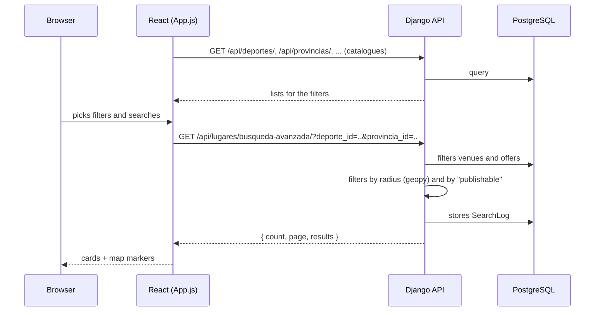

!!! info "Translation"
    This page is a translation of the [Spanish version](../arquitectura/), which is the source of truth. If they differ, the Spanish version is correct.

# Architecture

## Overview

- **Frontend** (`deporteca_frontend/`): a single React app. `App.js` is the main component: it holds almost all the state, loads the catalogues and runs the searches. The other components (`MainContent`, `LugarCard`, `MapComponent`, `LugarForm`, etc.) receive data and functions through props.
- **Backend** (`deporteca_project/`): a Django project with a single app, `lugares`, containing the models, the API (DRF), filters, signals and the Django admin configuration.
- **Django admin** (`/admin/`): the real management panel. This is where requests are reviewed, organisations approved and catalogues edited.

## Search flow

This is the main flow of the application.

1. On startup the frontend loads every **catalogue** from Django (sports, provinces, autonomous communities, sexes, age categories, event, competition and service types, venue types). These fill the filter dropdowns.
2. A search calls `busqueda-avanzada`. Django:
    - searches the text in name, description and address, ranking names that **start** with the text highest;
    - filters by province, community, venue type and by **sports offers** (sport, sex, age, competition, service, all exact matches);
    - if it receives `latitud`, `longitud` and `radio_km`, keeps only the venues inside that radius;
    - **returns only publishable venues** (see [Entity lifecycle](ciclo-de-vida-entidad.md));
    - records the search in `SearchLog` for the statistics.
3. The frontend renders the results as cards and as markers on the Leaflet map.

## Two backends: Django and Firestore

The project started as a Firebase app and later moved to Django. Today both coexist, and that causes bugs:

| Feature | Writes to | Reads from |
|---|---|---|
| Search, map and cards | — | **Django** |
| Create, edit and delete venue (`LugarForm`, admin panel) | **Django** | Django |
| Contact form / organisation sign-up | **Django** (`/api/contactos/`) | Django admin |
| Suggest a place (simple message) | **Django** (`/api/sugerencias/`) | Django admin |
| Suggest a place (full form, `SuggestPlaceForm`) | **Firestore** + Firebase Storage (logo) | nobody reads it back |
| Admin content manager (sports, etc.) | **Firestore** | catalogues are read from **Django**: changes never show |
| Live subscription to Firestore `lugares` | — | stored in `allLugares`, which is **never used** |
| Administrator role | — | **Firestore** (`artifacts/deporteca/users/{uid}/roles/role_id`) |

**In practice Django is the source of truth.** Firebase only provides anonymous login, the administrator role and logo uploads. The pending decision is in [Known issues](problemas-conocidos.md).

## External services

| Service | What for | Where |
|---|---|---|
| Nominatim (OpenStreetMap) | Geocoding addresses to coordinates | Backend (`Lugar.save()`, `/api/address-suggestions/search/`) and frontend (search from the landing page) |
| Google Places | Address autocomplete | Frontend (`PlaceAutocomplete.jsx`) |
| Firebase | Anonymous auth, Firestore, Storage | Frontend (`App.js`) |
| CARTO / OpenStreetMap | Map tiles | Frontend (`MapComponent.js`) |
| SMTP | Email notice for new organisation requests | Backend (`lugares/signals.py`) |
