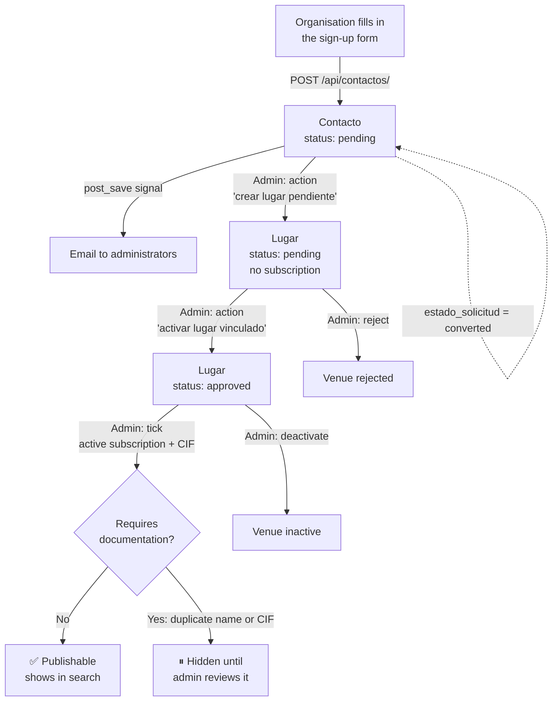

!!! info "Translation"
    This page is a translation of the [Spanish version](../ciclo-de-vida-entidad/), which is the source of truth. If they differ, the Spanish version is correct.

# Entity lifecycle

How a sports organisation goes from "I want to be listed" to "I show up in the search".

## Full flow



## Step by step

1. **Request.** The organisation fills in the sign-up form on the site (`EntityRegistrationModal.jsx`), which sends `POST /api/contactos/`. A `Contacto` is created with `estado_solicitud = pending`.
2. **Notice.** A signal (`lugares/signals.py`) emails the addresses in `ENTITY_REQUEST_NOTIFICATION_EMAILS`, or `ADMINS` if that variable is empty. In development the email is printed to the console.
3. **Conversion.** In the Django admin → *Contactos*, the action **"crear lugar pendiente"** (create pending venue) creates a `Lugar` from the request data (`estado_aprobacion = pending`, `suscripcion_activa = False`) and marks the request as `converted`.
4. **Activation.** The action **"activar lugar vinculado"** (activate linked venue) sets the venue to `approved` and the request to `activated`.
5. **Subscription and CIF.** To make the venue visible, an administrator must also tick `suscripcion_activa` and check that it has a `cif`. Step 4 does **not** activate the subscription (see [Known issues](problemas-conocidos.md)).
6. **Publication.** Once `puede_publicar_contenido` is `True`, the venue appears in `busqueda-avanzada`, and sports offers can be added to it.

## Automatic rules when saving a `Lugar`

- **Geocoding:** if it has a `direccion` but no coordinates, Nominatim is queried. If that fails, the venue is still saved without coordinates.
- **Duplicate check:** if another organisation has the same name or the same CIF, `requiere_documentacion = True` is set with the reason. This prevents someone impersonating another organisation. The venue stays hidden until an administrator resolves it.

## Publication rule

```python
puede_publicar_contenido = (
    estado_aprobacion == 'approved'
    and cif
    and not requiere_documentacion
    and suscripcion_activa
)
```

| Missing… | Message the organisation sees (`avisos_publicacion`) |
|---|---|
| Approval | "Tu entidad esta pendiente de revision por administracion." (pending admin review) |
| CIF | "Debes completar el CIF para poder publicar ofertas y eventos." (fill in the CIF) |
| Subscription | "Debes activar la cuota para publicar ofertas y eventos." (activate the fee) |
| Documentation | The computed reason (duplicate name/CIF) |

The `GET /api/lugares/{id}/estado-publicacion/` endpoint returns this status for a specific venue.
