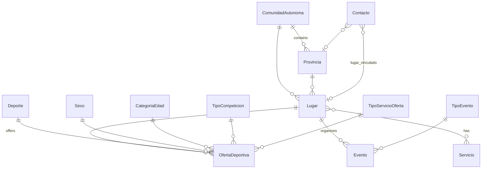

!!! info "Translation"
    This page is a translation of the [Spanish version](../modelo-de-datos/), which is the source of truth. If they differ, the Spanish version is correct.

# Data model

All models live in `deporteca_project/lugares/models.py`. The database is PostgreSQL.

## Diagram

## Main entity: `Lugar` (venue)

A venue is a sports organisation that appears in the search.

| Field | Purpose |
|---|---|
| `nombre`, `descripcion`, `tipo` | Basic data. `tipo`: `gimnasio` (gym), `piscina` (pool), `centro` (sports centre), `club_asociacion` (club/association), `otro` (other) |
| `cif` | Spanish tax ID. Required to publish |
| `estado_aprobacion` | `pending` / `approved` / `rejected` / `inactive` |
| `suscripcion_activa` | Active subscription fee. Required to publish |
| `requiere_documentacion`, `motivo_documentacion` | Computed automatically on save (duplicate name or CIF) |
| `direccion`, `latitud`, `longitud` | Location. An address without coordinates is geocoded on save |
| `comunidad_autonoma`, `provincia` | Administrative location |
| `telefono`, `email`, `web`, `instagram_link`, `x_link` | Contact |
| `logo` (file) / `logo_url` (external link) | Logo |
| `servicios` | Venue services (M2M with `Servicio`) |
| `accesible` | Accessibility |

**Computed properties:**

- `puede_publicar_contenido`: `True` only if the venue is approved, has a CIF, has an active subscription and doesn't require documentation. This is the rule that decides whether a venue shows up in the public search.
- `avisos_publicacion`: a list of messages explaining what the organisation is missing in order to publish.

The Django admin has *proxy models* per type (`LugarGimnasio`, `LugarPiscina`, `LugarClubAsociacion`, `LugarCentroDeportivo`, `LugarOtro`). They are the same table filtered by `tipo`.

## `OfertaDeportiva` (sports offer)

What a venue offers: **a combination of sport × sex × age category × competition type × service type**. For example: *Basketball · Female · Under-14 · Federated · School*. The combination is unique per venue.

- Offers can only be created on **publishable** venues. `clean()` validates this and raises an error otherwise.
- When the frontend saves a venue with several ages and sexes for the same sport, the backend creates one offer per combination (Cartesian product).
- `activa`: only active offers are returned by the API.

## `Evento` (event)

A venue's events (tournaments, open days, etc.): `titulo`, `tipo_evento`, `descripcion` (max. 140 characters), `fecha_inicio`, `fecha_fin`, `precio`, `es_gratuito`, `link_noticia`.

## Requests and suggestions

| Model | What it is | How it's created |
|---|---|---|
| `Contacto` | An organisation's sign-up request (or a contact message). Holds the organisation's data, `estado_solicitud` (`pending` / `converted` / `activated` / `rejected`) and `lugar_vinculado` | Public form → `POST /api/contactos/` |
| `ContactoPendiente` | Proxy of `Contacto` showing only pending requests in the admin | — |
| `Sugerencia` | A user suggests a missing place: `name`, `address`, `description` | `POST /api/sugerencias/` |

## Catalogues

Small tables holding the filter values. Managed in the Django admin and loaded with `python manage.py seed_catalogos`:

`Deporte` (with icon: `icon_image` or `icon_url`) · `Sexo` · `CategoriaEdad` · `TipoCompeticion` · `TipoServicioOferta` · `TipoEvento` · `Servicio` · `ComunidadAutonoma` · `Provincia`

## Analytics: `SearchLog`

Every call to `busqueda-avanzada` stores the filters used and the number of results. It feeds `GET /api/lugares/estadisticas-busqueda/` (admin only): most-searched provinces, sports, etc.
