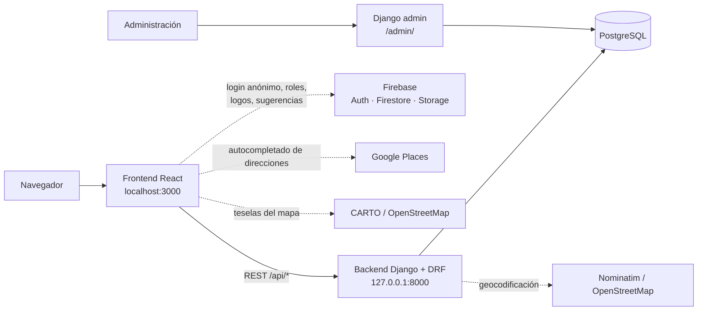
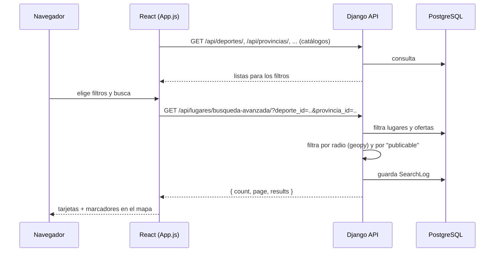

# Arquitectura

## Visión general

- **Frontend** (`deporteca_frontend/`): una única aplicación React. `App.js` es el componente principal: guarda casi todo el estado, carga los catálogos y lanza las búsquedas. Los demás componentes (`MainContent`, `LugarCard`, `MapComponent`, `LugarForm`, etc.) reciben datos y funciones por props.
- **Backend** (`deporteca_project/`): un proyecto Django con una sola app, `lugares`, que contiene modelos, API (DRF), filtros, señales y la configuración del Django admin.
- **Django admin** (`/admin/`): es el panel real de gestión. Aquí se revisan solicitudes, se aprueban entidades y se editan catálogos.

## Flujo de búsqueda

Es el flujo principal de la aplicación.

1. Al arrancar, el frontend carga todos los **catálogos** desde Django (deportes, provincias, comunidades autónomas, sexos, categorías de edad, tipos de evento, competición y servicio, tipos de lugar). Con ellos rellena los desplegables de filtros.
2. Al buscar, llama a `busqueda-avanzada`. Django:
    - busca el texto en nombre, descripción y dirección, y da más relevancia a los nombres que **empiezan** por el texto;
    - filtra por provincia, comunidad, tipo de lugar y por las **ofertas deportivas** (deporte, sexo, edad, competición, servicio, todas con coincidencia exacta);
    - si recibe `latitud`, `longitud` y `radio_km`, se queda solo con los lugares dentro de ese radio;
    - **devuelve solo lugares publicables** (ver [Ciclo de vida de una entidad](ciclo-de-vida-entidad.md));
    - registra la búsqueda en `SearchLog` para las estadísticas.
3. El frontend pinta los resultados como tarjetas y como marcadores en el mapa Leaflet.

## Dos backends: Django y Firestore

El proyecto empezó como una app de Firebase y después pasó a Django. Hoy conviven los dos, y eso causa errores:

| Funcionalidad | Escribe en | Lee de |
|---|---|---|
| Búsqueda, mapa y tarjetas | — | **Django** |
| Crear, editar y borrar lugar (`LugarForm`, panel admin) | **Django** | Django |
| Formulario de contacto / alta de entidad | **Django** (`/api/contactos/`) | Django admin |
| Sugerir un lugar (mensaje simple) | **Django** (`/api/sugerencias/`) | Django admin |
| Sugerir un lugar (formulario completo, `SuggestPlaceForm`) | **Firestore** + Firebase Storage (logo) | nadie lo vuelve a leer |
| Gestor de contenido del admin (deportes, etc.) | **Firestore** | los catálogos se leen de **Django**: los cambios no se ven |
| Suscripción en vivo a `lugares` de Firestore | — | se guarda en `allLugares`, que **no se usa** |
| Rol de administrador | — | **Firestore** (`artifacts/deporteca/users/{uid}/roles/role_id`) |

**En la práctica, Django es la fuente de verdad.** Firebase solo aporta el login anónimo, el rol de administrador y la subida de logos. La decisión pendiente está en [Problemas conocidos](problemas-conocidos.md).

## Servicios externos

| Servicio | Para qué | Dónde |
|---|---|---|
| Nominatim (OpenStreetMap) | Geocodificar direcciones a coordenadas | Backend (`Lugar.save()`, `/api/address-suggestions/search/`) y frontend (búsqueda desde la portada) |
| Google Places | Autocompletado de direcciones | Frontend (`PlaceAutocomplete.jsx`) |
| Firebase | Auth anónima, Firestore, Storage | Frontend (`App.js`) |
| CARTO / OpenStreetMap | Teselas del mapa | Frontend (`MapComponent.js`) |
| SMTP | Aviso por email de nuevas solicitudes de entidad | Backend (`lugares/signals.py`) |
