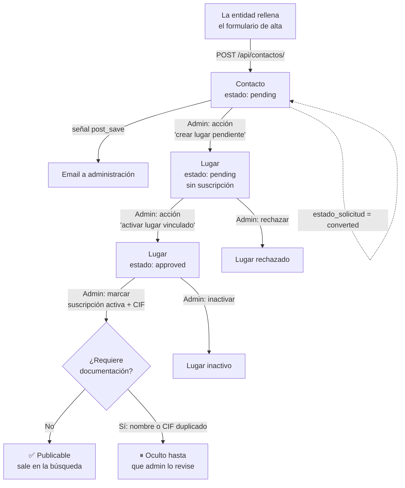

# Ciclo de vida de una entidad

Cómo pasa una entidad deportiva de "quiero aparecer" a "salgo en el buscador".

## Flujo completo



## Paso a paso

1. **Solicitud.** La entidad rellena el formulario de alta en la web (`EntityRegistrationModal.jsx`), que envía `POST /api/contactos/`. Se crea un `Contacto` con `estado_solicitud = pending`.
2. **Aviso.** Una señal (`lugares/signals.py`) envía un email a las direcciones de `ENTITY_REQUEST_NOTIFICATION_EMAILS`, o a `ADMINS` si esa variable está vacía. En desarrollo el email se imprime en la consola.
3. **Conversión.** En el Django admin → *Contactos*, la acción **"crear lugar pendiente"** crea un `Lugar` con los datos de la solicitud (`estado_aprobacion = pending`, `suscripcion_activa = False`) y marca la solicitud como `converted`.
4. **Activación.** La acción **"activar lugar vinculado"** pone el lugar en `approved` y la solicitud en `activated`.
5. **Suscripción y CIF.** Para que el lugar sea visible, la administración tiene que marcar también `suscripcion_activa` y comprobar que tiene `cif`. El paso 4 **no** activa la suscripción (ver [Problemas conocidos](problemas-conocidos.md)).
6. **Publicación.** Cuando `puede_publicar_contenido` es `True`, el lugar sale en `busqueda-avanzada` y ya se le pueden añadir ofertas deportivas.

## Reglas automáticas al guardar un `Lugar`

- **Geocodificación:** si tiene `direccion` pero no coordenadas, se consultan a Nominatim. Si falla, se guarda igualmente sin coordenadas.
- **Control de duplicados:** si otra entidad tiene el mismo nombre o el mismo CIF, se marca `requiere_documentacion = True` con el motivo. Así se evita que alguien suplante a otra entidad. El lugar queda oculto hasta que la administración lo resuelva.

## Regla de publicación

```python
puede_publicar_contenido = (
    estado_aprobacion == 'approved'
    and cif
    and not requiere_documentacion
    and suscripcion_activa
)
```

| Falta… | Mensaje que ve la entidad (`avisos_publicacion`) |
|---|---|
| Aprobación | "Tu entidad esta pendiente de revision por administracion." |
| CIF | "Debes completar el CIF para poder publicar ofertas y eventos." |
| Suscripción | "Debes activar la cuota para publicar ofertas y eventos." |
| Documentación | El motivo calculado (nombre/CIF duplicado) |

El endpoint `GET /api/lugares/{id}/estado-publicacion/` devuelve este estado para un lugar concreto.
