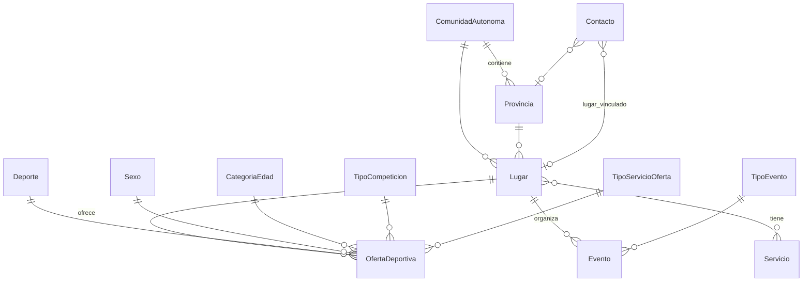

# Modelo de datos

Todos los modelos están en `deporteca_project/lugares/models.py`. La base de datos es PostgreSQL.

## Diagrama

## Entidad principal: `Lugar`

Un lugar es una entidad deportiva que aparece en el buscador.

| Campo | Para qué |
|---|---|
| `nombre`, `descripcion`, `tipo` | Datos básicos. `tipo`: `gimnasio`, `piscina`, `centro`, `club_asociacion`, `otro` |
| `cif` | Identificador fiscal. Obligatorio para publicar |
| `estado_aprobacion` | `pending` / `approved` / `rejected` / `inactive` |
| `suscripcion_activa` | Cuota activa. Obligatoria para publicar |
| `requiere_documentacion`, `motivo_documentacion` | Se calculan solos al guardar (nombre o CIF duplicado) |
| `direccion`, `latitud`, `longitud` | Ubicación. Si hay dirección sin coordenadas, se geocodifica al guardar |
| `comunidad_autonoma`, `provincia` | Ubicación administrativa |
| `telefono`, `email`, `web`, `instagram_link`, `x_link` | Contacto |
| `logo` (archivo) / `logo_url` (enlace externo) | Logo |
| `servicios` | Servicios del lugar (M2M con `Servicio`) |
| `accesible` | Accesibilidad |

**Propiedades calculadas:**

- `puede_publicar_contenido`: `True` solo si está aprobado, tiene CIF, tiene la suscripción activa y no requiere documentación. Es la regla que decide si un lugar sale en la búsqueda pública.
- `avisos_publicacion`: lista de mensajes que explican qué le falta a la entidad para poder publicar.

Para el Django admin existen *modelos proxy* por tipo (`LugarGimnasio`, `LugarPiscina`, `LugarClubAsociacion`, `LugarCentroDeportivo`, `LugarOtro`). Son la misma tabla filtrada por `tipo`.

## `OfertaDeportiva`

Qué ofrece un lugar: **una combinación de deporte × sexo × categoría de edad × tipo de competición × tipo de servicio**. Por ejemplo: *Baloncesto · Femenino · Infantil · Federada · Escuela*. La combinación es única por lugar.

- Solo se pueden crear ofertas en lugares **publicables**. `clean()` lo valida y lanza un error si no.
- Cuando el frontend guarda un lugar con varias edades y sexos para un mismo deporte, el backend crea una oferta por cada combinación (producto cartesiano).
- `activa`: solo las ofertas activas se devuelven en la API.

## `Evento`

Eventos de un lugar (torneos, jornadas, etc.): `titulo`, `tipo_evento`, `descripcion` (máx. 140 caracteres), `fecha_inicio`, `fecha_fin`, `precio`, `es_gratuito`, `link_noticia`.

## Solicitudes y sugerencias

| Modelo | Qué es | Cómo se crea |
|---|---|---|
| `Contacto` | Solicitud de alta de una entidad (o mensaje de contacto). Contiene los datos de la entidad, `estado_solicitud` (`pending` / `converted` / `activated` / `rejected`) y `lugar_vinculado` | Formulario público → `POST /api/contactos/` |
| `ContactoPendiente` | Proxy de `Contacto` para ver solo las pendientes en el admin | — |
| `Sugerencia` | Un usuario sugiere un lugar que no está: `name`, `address`, `description` | `POST /api/sugerencias/` |

## Catálogos

Tablas pequeñas con los valores de los filtros. Se gestionan en el Django admin y se cargan con `python manage.py seed_catalogos`:

`Deporte` (con icono: `icon_image` o `icon_url`) · `Sexo` · `CategoriaEdad` · `TipoCompeticion` · `TipoServicioOferta` · `TipoEvento` · `Servicio` · `ComunidadAutonoma` · `Provincia`

## Analítica: `SearchLog`

Cada llamada a `busqueda-avanzada` guarda los filtros usados y el número de resultados. Alimenta `GET /api/lugares/estadisticas-busqueda/` (solo administración): provincias y deportes más buscados, etc.
